# Project 1: Cross-Lingual Support Copilot (Arabic + English Queries → English Knowledge Base)

**Working name:** Musaid (مساعد)
**Timeline:** ~10 weeks part-time (10–15 hrs/week)
**Owner:** Ihsan Hadhrami

---

## 1. Ultimate Goal

### Career goal
Get hired as an **AI Engineer / AI Implementation Engineer / Applied AI Engineer** at a MENA-facing SaaS company, BPO, or AI consultancy. The project should prove you can build, measure, and run a production RAG system for the most common real-world MENA setup: **documentation in English, customers asking in Arabic.**

### Product goal
A support assistant for a fictional payments company whose knowledge base is **100% English**, which:
- accepts questions in **English, Modern Standard Arabic (MSA), Gulf and Levantine/Egyptian dialects, code-switched Arabic–English, and Arabizi** (Arabic in Latin script, e.g., "kif arja3 floosi"),
- retrieves the correct **English** policy passage regardless of query language,
- answers **in the user's language**, preserving numbers, fees, deadlines, and country-specific rules exactly,
- cites the English source passage behind every answer,
- asks a clarifying question when the answer depends on information the user didn't give (e.g., country),
- **refuses and escalates to a human** when confidence is low or the question is out of scope,
- runs in production with cost, latency, and quality monitoring.

### The core research question
> **What is the most accurate and cost-effective way to retrieve English policy documents from dialectal Arabic, code-switched, and Arabizi queries?**

Every experiment in this project serves that question.

### The real deliverable
1. **A public cross-lingual benchmark**: an English support KB + Arabic/English queries with gold passages + an Arabic→English support terminology glossary, on Hugging Face.
2. **A results table from controlled experiments (ablations)** comparing direct multilingual retrieval vs. translate-then-retrieve vs. combined approaches, broken down by language variety.
3. **A live, monitored deployment** with an eval gate in CI that blocks quality regressions.

### Success criteria (definition of done)
| Area | Criterion |
|---|---|
| Knowledge base | 150–300 English articles, deliberately realistic and messy, published |
| Benchmark | ≥450 labeled queries across 6 language varieties, dev/test split, dataset card |
| Glossary | ≥150 Arabic/dialect/Arabizi → English term mappings, published |
| Retrieval | Ablation table covering ≥8 configurations on the locked test set |
| Answers | Faithfulness, cross-lingual fidelity (numbers/terms), and language match measured |
| Escalation | Unanswerable and ambiguous queries handled correctly, measured |
| Production | Public demo URL, Dockerized, observability dashboard, CI eval gate |
| Packaging | README with metrics up front, 3-min video, 1 technical write-up |

> Target numbers in section 7 are **starting targets**. Set real ones after the baseline. Report honest results even if they miss; a well-explained miss beats an unexplained win.

---

## 2. Scope

**In scope**
- Single-turn and short multi-turn Q&A over a fixed English KB
- Queries in English and five Arabic varieties
- Cross-lingual retrieval (direct multilingual embeddings, query translation, combined)
- Terminology-glossary-assisted query rewriting
- Metadata-aware retrieval (country, effective date)
- Grounded answers in the user's language with citations to English sources
- Clarifying questions, confidence-based escalation
- Evaluation harness, API, RTL-capable web UI, deployment

**Out of scope (on purpose)**
- Arabic-language documents in the KB
- Fine-tuning any model
- GraphRAG, multi-agent systems, voice
- Account-specific actions (refunds, password resets); the copilot answers from documentation only

Cutting scope is a senior engineering signal. Say so in the README.

---

## 3. Architecture

```mermaid
flowchart LR
    U[User query] --> LID[Language + variety detection\nEN / MSA / dialect / code-switch / Arabizi]
    LID -- English --> Q[Query set]
    LID -- Arabic variety --> N[Query normalization\nArabic + Arabizi]
    N --> T[Translate to English\nglossary-assisted]
    N --> Q
    T --> Q
    Q --> L[BM25 on English KB\nEnglish + translated query]
    Q --> D[Dense multilingual search\noriginal + translated query]
    L --> F[Reciprocal Rank Fusion]
    D --> F
    F --> MF[Metadata filter / boost\ncountry, effective date]
    MF --> R[Cross-encoder reranker]
    R --> C{Confident?\nCountry known if needed?}
    C -- Ambiguous --> CQ[Ask clarifying question]
    C -- Low confidence --> E[Escalate to human]
    C -- Yes --> G[Generate answer\nin user's language + citations]
    G --> V[Citation + fidelity check\nnumbers, fees, dates, terms]
    V --> A[Answer + English source passage]
    A --> O[(Langfuse traces:\ncost, latency, scores)]
```



**Offline pipeline:** author KB → clean → structure-aware chunking → attach metadata → embed → index (pgvector + BM25).

**Design principle:** English queries skip normalization and translation entirely, so they pay no extra latency or cost. Verify that English performance never regresses when Arabic features are added.

---

## 4. Tech Stack

| Layer | Choice | Why | Alternative for ablation / scale |
|---|---|---|---|
| Language | Python 3.12, `uv` for env/deps | Industry default; fast, reproducible | Poetry |
| API | FastAPI + Pydantic v2 | Named in Gulf job postings; typed models | — |
| Database | PostgreSQL 16 + **pgvector** (HNSW index) | One store for docs, metadata, vectors; metadata filtering in SQL | Qdrant |
| Lexical search | `bm25s` on English text | Works on English queries and translated Arabic queries | OpenSearch |
| Embeddings (primary) | **BAAI/bge-m3** | Strong multilingual model; maps Arabic queries and English docs into one space | `multilingual-e5-large`, one commercial multilingual embedding API |
| Reranker | **BAAI/bge-reranker-v2-m3** | Multilingual cross-encoder; can score Arabic query vs. English passage directly | Commercial rerank API |
| Fusion | Reciprocal Rank Fusion (RRF) | Combines multiple query versions and retrievers without tuning weights | Weighted fusion |
| Query-side Arabic NLP | **CAMeL Tools** (normalization, dediacritization, dialect ID), PyArabic | Purpose-built Arabic tooling | Custom regex normalizer |
| Arabizi handling | Rule-based transliteration map + LLM fallback | Arabizi is where most systems fail; a measurable weakness to fix | LLM-only |
| Language ID | fastText LID + CAMeL dialect ID + script check | Routes queries; tags results for per-variety analysis | — |
| Query translation | Small, cheap LLM with glossary injected into the prompt | Handles dialect and support jargon better than generic MT | Dedicated MT model (ablation only) |
| Generation LLM | One current frontier API model (e.g., Claude Sonnet) | Best Arabic generation from English sources | One open Arabic-capable model (e.g., Qwen, ALLaM, Jais) as ablation |
| IR metrics | **`ranx`** | Recall@k, MRR, nDCG, significance tests | `pytrec_eval` |
| Answer metrics | LLM-as-judge **validated against your own human labels** + rule-based fidelity checks | Judges are only credible when checked against humans | RAGAS (optional) |
| Observability | **Langfuse** (self-hosted) | Traces, cost, latency, scores per request | LangSmith, Helicone |
| Frontend | React (Vite) + Tailwind, RTL/bidi-aware | Arabic answers + English citations in one view break naive UIs | Gradio (internal demo) |
| Eval dashboard | Streamlit (internal) | Browse failures by variety/type | — |
| Testing | pytest | Normalizer, transliteration, chunker, fidelity checker, API | — |
| CI/CD | GitHub Actions: ruff, tests, **eval regression gate** | Production discipline | — |
| Packaging | Docker + Docker Compose | One-command local run | — |
| Deployment | Azure (preferred in Gulf postings) or AWS; small VPS acceptable for demo | Cloud name on CV matters for MENA roles | Hetzner / DigitalOcean |
| Dataset hosting | Hugging Face Datasets | Public, citable benchmark | — |

**Deliberately not used:** LangChain as the core. Build the pipeline yourself so you can explain every step in interviews. Optionally reimplement one configuration in LlamaIndex/LangChain to show familiarity.

---

## 5. Data Requirements

### 5.1 Hard rule
**No employer data, ever.** Nothing from Prometric, no real customer tickets, no internal docs, not even paraphrased. Pick a KB domain unrelated to testing or certification. Assume a hiring manager will ask where every piece of data came from.

### 5.2 Knowledge base: fictional English KB

**Company:** a fictional digital payments / e-wallet company (placeholder name: *Sahla Pay*) operating in **Saudi Arabia, UAE, and Egypt**. Payments is chosen because it produces precise, testable facts (fees, limits, deadlines) and country-specific rules.

| Requirement | Target |
|---|---|
| Language | **English only** |
| Size | 150–300 articles → roughly 1,000–3,000 chunks |
| Authoring | LLM for first drafts, then **heavy manual rewriting**; structure modeled on real help centers, no copied text |
| License | Your own work; publish in full (e.g., CC BY 4.0) |

**Content categories (suggested spread):**
| Category | Examples | Share |
|---|---|---|
| Account & verification (KYC) | Required documents, verification time, rejected ID | 15% |
| Transfers & payments | Limits, fees, international transfers, failed payments | 20% |
| Refunds & disputes | Refund eligibility, chargebacks, timelines | 15% |
| Cards | Card activation, blocked card, replacement fees | 15% |
| Fees & limits | Fee schedules per country, daily/monthly limits | 10% |
| Security | Fraud, OTP issues, account takeover | 10% |
| Troubleshooting | App errors, login problems, notifications | 10% |
| Legal & policy | Terms, privacy, account closure, dormant accounts | 5% |

**Mandatory "realistic mess"** (this is what makes the benchmark meaningful):
- **Country-specific rules**: the same topic with different limits/fees/timelines for KSA, UAE, Egypt (at least 25 topics)
- **Buried exceptions**: the rule in paragraph 1, the exception in paragraph 3
- **Near-duplicate articles**: e.g., "Refund timelines" vs. "When will I get my money back?"
- **Superseded policies**: an old article plus its replacement, with effective dates
- **Precise numbers**: fees, percentages, limits, day counts, currencies (SAR, AED, EGP)
- **Cross-references**: "See also: Transfer limits"
- **Mixed formats**: FAQs, numbered procedures, fee tables, long policy text

**Document schema (`kb.jsonl`):**
```json
{
  "doc_id": "kb-0142",
  "title": "International transfer fees",
  "category": "fees_limits",
  "section_path": ["Transfers", "International"],
  "countries": ["SA", "AE"],
  "effective_date": "2026-03-01",
  "superseded_by": null,
  "article_type": "fee_table",
  "text": "..."
}
```

### 5.3 Terminology glossary

Customers don't use policy vocabulary. The glossary maps how people ask to how the KB is written.

| Requirement | Target |
|---|---|
| Size | ≥150 entries |
| Coverage | MSA, Gulf, Levantine/Egyptian variants, and Arabizi spellings per concept |
| Use | Injected into the query-translation prompt; tested as an ablation |

**Schema (`glossary.jsonl`):**
```json
{
  "kb_term": "refund",
  "variants": {
    "msa": ["استرداد", "استرداد المبلغ"],
    "gulf": ["ارجاع الفلوس", "ترجع فلوسي"],
    "levantine_egyptian": ["رجوع الفلوس", "ترجيع الفلوس"],
    "arabizi": ["arja3 floosi", "tarja3 el floos"]
  }
}
```

### 5.4 Evaluation dataset (the centerpiece)

| Requirement | Target |
|---|---|
| Size | ≥450 queries (dev 175 / **test 275, locked**; never tune on test) |
| Author | You, writing as a real customer would |
| Gold labels | 1–3 gold `chunk_id`s per answerable query + short reference answer in English |
| Unanswerable | 10–15% have no answer in the KB (tests escalation) |
| Ambiguous | ~8% depend on country but don't state it (tests clarifying questions) |
| Parallel subset | 40 intents written in **all six varieties** (240 queries, counted within the 450), so you can compare varieties on identical intent; the remaining queries follow the distribution below |
| Agreement check | A second Arabic speaker independently labels 50 queries; report agreement |

**Language variety distribution (target):**
| Variety | Share |
|---|---|
| English | 30% |
| MSA | 20% |
| Gulf dialect | 18% |
| Levantine / Egyptian | 12% |
| Code-switched Arabic–English | 12% |
| Arabizi | 8% |

**Query types:** factual, procedural, troubleshooting, policy/eligibility, country-specific, number-sensitive (fees/limits/deadlines), multi-hop (answer spans 2 chunks), superseded-policy trap (old article looks relevant), ambiguous, unanswerable.

**Query schema (`queries.jsonl`):**
```json
{
  "qid": "q-0231",
  "query": "ابي ارجع فلوسي من تحويل غلط، كم ياخذ وقت؟",
  "variety": "gulf",
  "script": "arabic",
  "type": "number_sensitive",
  "country": "SA",
  "answerable": true,
  "needs_clarification": false,
  "gold_chunk_ids": ["kb-0088#c2"],
  "reference_answer": "Wrong-transfer refunds in Saudi Arabia take up to 5 business days after the dispute is approved.",
  "critical_facts": ["5 business days", "after dispute approval"],
  "parallel_group": "pg-017",
  "difficulty": "medium",
  "split": "test"
}
```

`critical_facts` powers the automated fidelity check: every listed fact must appear correctly in the Arabic or English answer.

### 5.5 Human-labeled judge-calibration set
- 80–100 generated answers (at least half in Arabic varieties) scored by hand for **faithfulness**, **correctness**, and **fidelity** (numbers/terms preserved).
- Measure LLM-judge agreement with you, separately for English and Arabic answers.

### 5.6 Real-world sanity check (not published)
- 30–50 queries against **one real public English help center** (payments or telecom), run locally only.
- Purpose: show the system isn't only good on data you wrote. Report aggregate metrics only; don't redistribute the content.

---

## 6. Step-by-Step Implementation

### Phase 0: Setup (Week 1)
1. Repo, `uv`, ruff, pytest, pre-commit.
2. Docker Compose: Postgres + pgvector, Langfuse.
3. `docs/DECISIONS.md`: one short architecture decision record per major choice.

**Done when:** `docker compose up` works; CI runs lint + tests on push.

### Phase 1: Knowledge base authoring (Weeks 1–3)
1. Write a KB style guide (tone, article structure, how fees/tables are formatted).
2. Define the country matrix: which topics differ by country, and the exact values.
3. Draft articles with an LLM from outlines; **rewrite each by hand**; inject the mandatory mess from 5.2.
4. Keep a `facts.csv` source-of-truth (topic, country, value, effective date) and check that articles agree with it; this prevents accidental contradictions.
5. **Structure-aware chunking:** split on headings, numbered steps, and table boundaries; ~200–400 tokens; never split a procedure or fee table; prepend title + section path + country to each chunk.
6. Write KB stats (articles, chunks, category/country spread).

**Done when:** `kb.jsonl`, `chunks.jsonl`, `facts.csv` exist; 30 random chunks inspected by hand.

### Phase 2: Glossary + evaluation dataset, **before** building retrieval (Weeks 3–4)
1. Build the glossary from the KB's key terms; add dialect and Arabizi variants you'd actually hear.
2. Write `docs/ANNOTATION.md`: gold chunk rules, variety definitions, what counts as ambiguous/unanswerable, how to write `critical_facts`.
3. Write queries per 5.4, including the parallel subset.
4. Label gold chunks with a search helper; verify each by reading it.
5. Second-annotator check on 50 queries; compute agreement.
6. Split dev/test; hash and lock the test file.

**Done when:** ≥450 validated queries, glossary ≥150 entries, test set locked.
**Why first:** writing queries before the system exists stops you from unconsciously writing only what the system already handles.

### Phase 3: Baselines (Weeks 4–5)
1. Eval harness: `run_retrieval(config) → rankings → ranx metrics`, broken down by **variety**, **query type**, and **parallel group**.
2. **Baseline A:** BM25 on the raw query. Expect near-zero recall for Arabic-script queries; this is your floor and shows why cross-lingual methods are needed.
3. **Baseline B:** dense bge-m3 on the raw query (direct cross-lingual retrieval).
4. Save every run as JSON with its config.

**Done when:** both baselines with full breakdowns; you can name the weakest variety and the weakest query type.

### Phase 4: Cross-lingual retrieval ablations (Weeks 5–7)
Change **one variable at a time**; measure on dev:

| # | Configuration | Question it answers |
|---|---|---|
| 1 | BM25, raw query | Floor |
| 2 | Dense bge-m3, raw query | How good is direct multilingual retrieval? |
| 3 | Dense, alternative multilingual embedding | Does the model choice matter for dialects? |
| 4 | Translate → English, then BM25 | Is translation alone enough? |
| 5 | Translate → English, then hybrid (BM25 + dense) | Does hybrid help after translation? |
| 6 | **Multi-query fusion**: dense(original) + BM25(translated) + dense(translated), RRF | Does combining both routes beat either? |
| 7 | #6 + reranker | How much does reranking add cross-lingually? |
| 8 | #7 + glossary-assisted translation | Does domain terminology fix jargon failures? |
| 9 | #8 + Arabizi transliteration step | Does explicit Arabizi handling close the worst gap? |
| 10 | #9 + metadata filter/boost (country, effective date) | Does metadata fix country and superseded-policy errors? |

Also track for each configuration: **added latency and cost per query** (translation is an extra LLM call). The best configuration must justify its cost.

Then run the top 3 configurations **once** on the locked test set, with `ranx` significance tests. Confirm English-query performance didn't drop.

**Done when:** ablation table with per-variety and per-type breakdowns, latency/cost columns, and at least one written insight you didn't expect.

### Phase 5: Generation, fidelity, clarification, escalation (Weeks 7–8)
1. **Answer prompt:** answer only from provided English chunks; reply in the user's language (dialect question → clear, friendly MSA with light dialect touches; decide and document); cite chunk IDs; keep numbers, currencies, and dates in Western digits or Arabic-Indic digits consistently (decide and document).
2. **Citation check:** cited IDs must be in the retrieved set; flag uncited claims.
3. **Fidelity check (rule-based):** extract numbers, currencies, durations, percentages from the answer and the cited chunk; flag any mismatch. Score against `critical_facts`.
4. **Language match:** detect the answer's language; must match the query's (Arabic query → Arabic answer).
5. **Clarifying questions:** if top chunks are country-specific with conflicting values and the query has no country, ask which country instead of guessing.
6. **Escalation:** reranker score threshold (+ optional LLM self-check); tune on dev; report the wrong-answer vs. unnecessary-escalation trade-off curve.
7. Build the LLM judge; validate against your 80–100 human labels, separately for English and Arabic answers.

**Done when:** faithfulness, fidelity, language match, clarification accuracy, and escalation metrics exist; judge validated.

### Phase 6: Production API and quality gate (Weeks 8–9)
1. FastAPI: `POST /ask` (returns answer, language, citations with English passages, status: answered / clarify / escalated), `GET /health`, `POST /feedback`.
2. Langfuse tracing: detected variety, query versions (original/normalized/translated), retrieval results, scores, tokens, cost, latency, final status.
3. Guardrails:
   - **Prompt injection:** retrieved text is data, never instructions; test 20 adversarial queries in both languages.
   - **PII redaction** in logs: phone, email, national ID and IBAN patterns for SA/AE/EG.
   - Timeouts, rate limits; if translation or generation fails, fall back to direct dense retrieval + escalation.
   - **Caching** of translations for repeated queries.
4. **CI eval gate:** each PR runs a 60-query smoke subset (balanced across varieties); fail if recall@5, faithfulness, or fidelity drops beyond tolerance, **in any variety**.
5. Load test (e.g., `locust`); record p50/p95 latency for English vs. Arabic paths.

**Done when:** containerized, traced, guarded, and a deliberately bad change (e.g., disabling the glossary) is caught by CI. Screenshot it.

### Phase 7: Frontend and deployment (Weeks 9–10)
1. React chat UI: auto RTL/LTR per message; correct bidi for mixed text and numbers; each answer shows the **English source passage** with an optional "translate this passage" toggle; visible clarify/escalated states; country selector as an optional setting.
2. Deploy API + DB + UI (container service + managed Postgres), HTTPS, env-based secrets.
3. Spending cap and per-IP rate limit on the public demo.

**Done when:** a stranger can open the URL on a phone, ask in Gulf dialect or Arabizi, and get a correct Arabic answer with an English citation.

### Phase 8: Packaging for hiring (Week 10)
1. Publish KB, glossary, and query benchmark to Hugging Face with a dataset card.
2. README (section 9).
3. 3-minute video: same question asked in English, Gulf, and Arabizi → same correct answer; ablation table; clarifying question; escalation; CI catching a regression.
4. Technical write-up: *"English docs, Arabic customers: what actually works for cross-lingual support RAG."*
5. Post on LinkedIn and in Arabic NLP communities.

### Phase 9: Real deployment (after Week 10, strongly recommended)
Deploy for one real business with English docs and Arabic-speaking customers, using their public FAQ with permission. Track real usage for 4+ weeks. This turns "portfolio project" into "production system with real users."

---

## 7. Evaluation Plan

### Retrieval metrics
- **Recall@5, Recall@10**, **MRR@10**, **nDCG@10**
- Broken down by **variety**, **query type**, and **parallel group**
- **Cross-lingual gap:** Arabic-variety recall@5 minus English recall@5 on the parallel subset (the headline number to shrink)

### Answer metrics
- **Faithfulness:** every claim supported by a cited chunk
- **Citation precision**
- **Correctness** vs. reference answer (validated judge)
- **Cross-lingual fidelity:** share of `critical_facts` (numbers, fees, deadlines, country rules) preserved exactly
- **Language match rate:** answer in the query's language
- **Clarification accuracy:** ambiguous queries → clarifying question; non-ambiguous → no unnecessary question
- **Refusal accuracy** on unanswerable; **false escalation rate** on answerable

### Operational metrics
- p50 / p95 latency (English path vs. Arabic path), cost per 1,000 queries, error rate, escalation rate

### Starting targets (revise after baseline)
| Metric | Starting target |
|---|---|
| Recall@5, English (best config, test) | ≥ 0.90 |
| Recall@5, Arabic varieties combined | ≥ 0.85; report each variety separately |
| Cross-lingual gap (parallel subset) | ≤ 5 points |
| Faithfulness | ≥ 0.90 |
| Cross-lingual fidelity (critical facts) | ≥ 0.95 |
| Language match | ≥ 0.98 |
| Refusal accuracy (unanswerable) | ≥ 0.80 |
| p95 latency | < 4 s (Arabic path) |
| Judge–human agreement | Report per language; trust judge numbers only where agreement is strong |

---

## 8. Repository Structure

```
musaid/
├── README.md
├── docker-compose.yml
├── pyproject.toml
├── docs/
│   ├── DECISIONS.md          # architecture decision records
│   ├── KB_STYLE_GUIDE.md     # how KB articles are written
│   ├── ANNOTATION.md         # labeling guidelines
│   └── RESULTS.md            # full ablation tables + analysis
├── data/
│   ├── kb/                   # kb.jsonl, chunks.jsonl, facts.csv
│   ├── glossary/             # glossary.jsonl
│   ├── eval/                 # queries.jsonl, judge_calibration.jsonl
│   └── sanity_check/         # gitignored: real-world queries + scripts only
├── src/musaid/
│   ├── lang/                 # language/variety ID, normalization, Arabizi transliteration
│   ├── translate/            # glossary-assisted query translation, caching
│   ├── ingest/               # chunking, metadata, embedding, indexing
│   ├── retrieval/            # bm25, dense, multi-query fusion, metadata filters, rerank
│   ├── generation/           # prompts, citation check, fidelity check, clarify, escalate
│   ├── api/                  # FastAPI app
│   └── observability/        # Langfuse wiring, PII redaction
├── eval/
│   ├── run_retrieval.py
│   ├── run_answers.py
│   ├── fidelity.py
│   ├── judge.py
│   └── results/              # one JSON per run, with config
├── frontend/                 # React + Tailwind, RTL/bidi-aware
├── tests/
└── .github/workflows/        # lint, test, eval gate
```

---

## 9. README Template (what hiring managers see first)

1. **One-line pitch:** Cross-lingual support RAG that answers Arabic (MSA, dialects, Arabizi) and English questions from an English-only knowledge base, with a public benchmark.
2. **Results table:** best config vs. baselines; English vs. each Arabic variety; cross-lingual gap; latency and cost.
3. **Live demo link + 3-min video.**
4. **Architecture diagram.**
5. **Key findings** (3 bullets, e.g., direct multilingual vs. translation, what the glossary fixed, how Arabizi was handled).
6. **Benchmark:** KB, glossary, queries; links, sizes, distribution, reproduction steps.
7. **Production:** observability screenshot, CI gate screenshot, p95 latency, cost per 1,000 queries.
8. **Limitations and next steps** (honest; this reads as seniority).
9. **Run locally:** `docker compose up`.

### CV bullet template (fill with real numbers only)
> Built a cross-lingual support RAG system answering Arabic (MSA, Gulf/Levantine dialects, Arabizi) and English queries from an English knowledge base (FastAPI, pgvector, multi-query hybrid retrieval, reranking); cut the Arabic–English retrieval gap from [X] to [Y] points and reached [Z]% factual fidelity on fees and deadlines; published a [N]-query benchmark with CI eval gating and Langfuse monitoring on a live deployment.

---

## 10. Risks and Mitigations

| Risk | Mitigation |
|---|---|
| Scope creep (agents, fine-tuning, voice) | Section 2 is the contract; new ideas go to a "Next" list |
| LLM-written KB too clean → inflated scores | Heavy manual rewriting, mandatory mess (5.2), real-world sanity check (5.6) |
| KB contradicts itself by accident | `facts.csv` as single source of truth, checked automatically |
| Eval set biased toward your own system | Build it before retrieval (Phase 2); lock test set |
| Translation step adds cost/latency | Skip for English; cache; cheap model; report cost per config |
| Numbers/fees mistranslated in Arabic answers | Rule-based fidelity check + `critical_facts` scoring |
| LLM judge unreliable in Arabic | Calibrate separately per language; report agreement |
| Small per-variety samples → overclaiming | Report sample sizes; use parallel subset and significance tests |
| Demo API costs spike | Spending cap, rate limit, caching |
| Burnout alongside a full-time job | Each phase has a standalone deliverable; ship publicly phase by phase |

---

## 11. Final Checklist

- [ ] KB style guide, country matrix, `facts.csv`
- [ ] 150–300 English articles with mandatory mess; chunked with metadata
- [ ] Glossary ≥150 entries across varieties and Arabizi
- [ ] ≥450 queries incl. parallel subset, ambiguous, unanswerable; annotation guide; agreement check; test locked
- [ ] Baselines + ≥8 cross-lingual ablations with latency/cost columns and significance tests
- [ ] English performance verified non-regressed
- [ ] Citation, fidelity, language-match, clarification, escalation all measured
- [ ] LLM judge calibrated per language
- [ ] FastAPI + Langfuse + guardrails + PII redaction + caching
- [ ] CI eval gate per variety that has visibly caught a regression
- [ ] Live deployment with RTL/bidi-correct UI and English source passages
- [ ] KB, glossary, benchmark on Hugging Face with dataset card
- [ ] Real-world sanity check results reported
- [ ] README, video, technical write-up published
- [ ] (Next) Real-user deployment for one business
